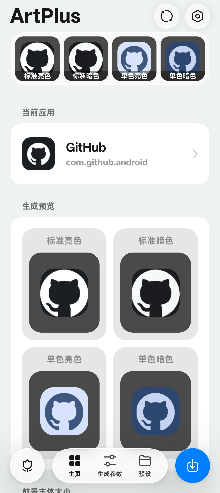
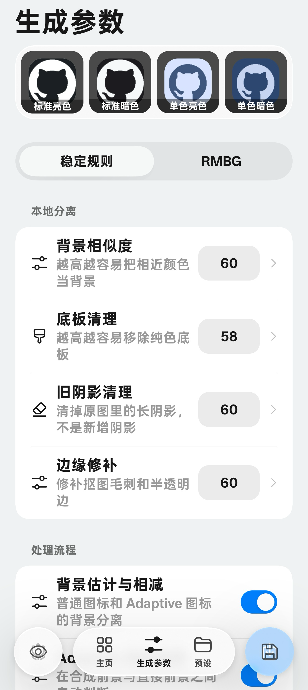
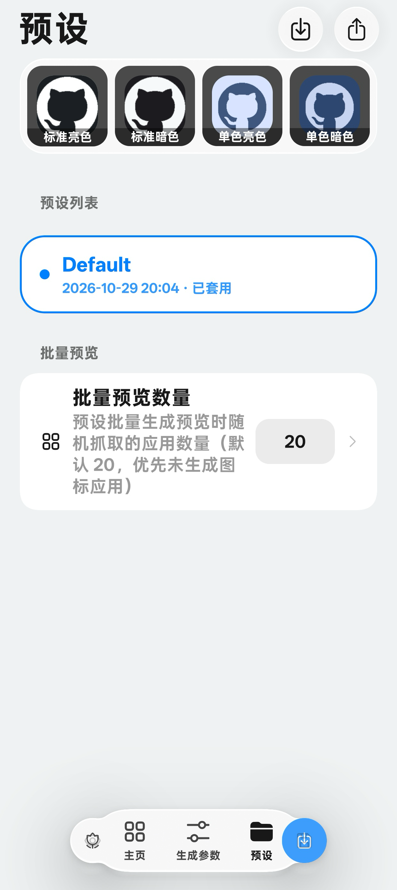
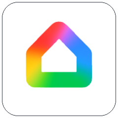
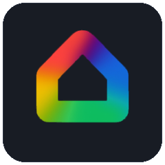
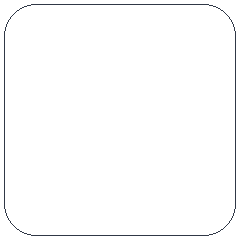
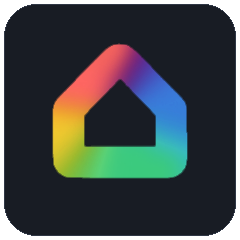
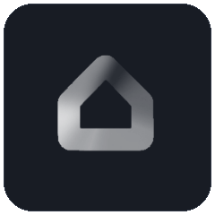

<div align="center">


# ArtPlus for Mobile

<p>Deconstruct, rebuild, and live-preview third-party app icons in native ColorOS ART+ spec</p>

[](https://developer.android.com)
[](https://kotlinlang.org)
[](https://developer.android.com/jetpack/compose)
[](https://github.com)
[](LICENSE)

<p><b>English</b> | <a href="README.zh-CN.md">简体中文</a></p>

</div>

---

## Overview

ColorOS ART+ (OPPO / OnePlus / realme) ships a distinctive layered icon style, but there is no official tool that converts ordinary third-party icons into ART+ compliant assets. ArtPlus fills that gap on-device:

1. Read the target app's launcher icon,
2. Split and rebuild it into foreground / background / night / monochrome layers with tunable algorithms,
3. Live-preview all variants, then write the result straight into the system ART+ directory (root) or export it as a shareable preset.

Designed for ColorOS 15+ theming workflows, built with Kotlin + Jetpack Compose (MIUIX Compose).

---

## Screenshots

<div align="center">
<table>
  <tr>
    <td align="center" width="33%">
      <br />
      <b>Home & Polymorphic Preview</b><br />
      <sub>Standard light/dark and monochrome light/dark</sub>
    </td>
    <td align="center" width="33%">
      <br />
      <b>Tuning Parameters</b><br />
      <sub>Stable rule-based tuning with top preview strip</sub>
    </td>
    <td align="center" width="33%">
      <br />
      <b>Preset Snapshots</b><br />
      <sub>Feature tags with import/export</sub>
    </td>
  </tr>
</table>
</div>

---

## ART+ Layered Output Spec

ArtPlus deconstructs a regular app icon and rebuilds it into a ColorOS ART+ compliant asset pack:

<div align="center">
<table>
  <tr>
    <th align="center">Original</th>
    <th align="center">Foreground (recfg)</th>
    <th align="center">Background (recbg)</th>
    <th align="center">Dark Mode (rec_night)</th>
    <th align="center">Monochrome</th>
  </tr>
  <tr>
    <td align="center"><br /><sub><b>Source icon</b></sub></td>
    <td align="center"><br /><sub><b>Subject foreground</b></sub></td>
    <td align="center"><br /><sub><b>Extended background</b></sub></td>
    <td align="center"><br /><sub><b>Dark adapted</b></sub></td>
    <td align="center"><br /><sub><b>Mono extraction</b></sub></td>
  </tr>
  <tr>
    <td align="center"><code>icon.png</code></td>
    <td align="center"><code>recfg.png</code></td>
    <td align="center"><code>recbg.png</code></td>
    <td align="center"><code>rec_night.png</code></td>
    <td align="center"><code>monochrome.png</code></td>
  </tr>
</table>
</div>

> Multi-ratio launcher tile sizes (`1x2`, `2x1`, `2x2`) are derived automatically to fit ColorOS home-screen layouts.

---

## Key Features

- **App discovery**: scan installed apps, separate launcher apps from background components, jump to the target app in one tap.
- **Smart layer separation**: on-device pipeline with background cleanup, foreground edge refinement, wordmark preservation, and monochrome generation.
- **Live full-state preview**: render standard light/dark, monochrome light/dark, and the 1×4 top strip in real time.
- **Preset snapshot library**: feature tags, tuning snapshots, per-item copy, and one-tap clipboard export/import.
- **Root fast write**: one-tap write into the system ART+ directory (`/data/oplus/uxicons/`), guarded by a double-confirm dialog with automatic launcher refresh.
- **Optional AI extension**: plug in an online image API to explore future-style icon candidates.

---

## Project Structure

```text
ArtPlus/
├── mobile/            # Android app source (Kotlin + Jetpack Compose)
│   └── src/main/
│       ├── kotlin/    # Business logic, layer algorithms, UI components
│       └── res/       # Native Android resources
├── docs/              # Design docs, release notes, README assets
│   └── assets/        # Screenshots and demo icons
├── uxicons/           # Curated standard ART+ icon assets
├── theme/             # Theme templates and styles
└── outputs/           # Generated results, temp previews, build artifacts
```

---

## Build from Source

Requirements:

- JDK 17+
- Android SDK (API 34+)
- Gradle 8.14+

```bash
# Debug APK
./gradlew :mobile:assembleDebug

# Release APK
./gradlew :mobile:assembleRelease
```

Output paths:

```text
mobile/build/outputs/apk/debug/mobile-debug.apk
mobile/build/outputs/apk/release/mobile-release.apk
```

---

## CI & Releases

The repo ships a GitHub Actions workflow:

- Manual trigger or version-tag push runs a full build.
- Signed release artifacts with checksums are published automatically.

Grab the latest APK from [Releases](https://github.com/Costben/ArtPlus/releases).

---

## Contributing

Issues and pull requests are welcome. If an icon converts badly, please attach the source icon, your tuning preset (exported text), device model, and ColorOS version.

---

## License

[GPL-3.0-or-later](LICENSE)
